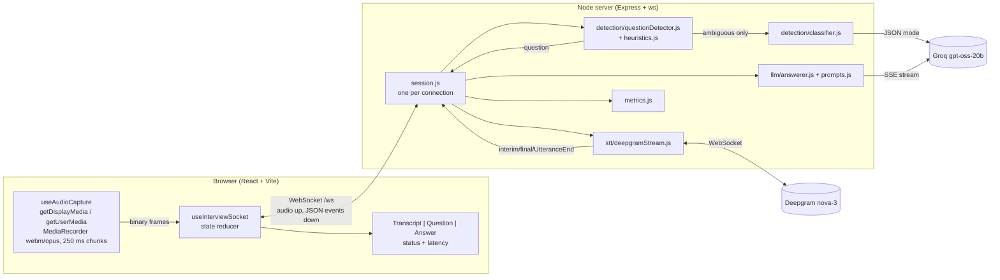

# Real-Time Interview Assistant (POC)

Listens to an interviewer, transcribes them live, detects when they've finished asking a question, and streams a short, speakable answer based on the candidate's resume and the job description.

```
Browser audio ──► streaming STT ──► question detection ──► streaming LLM answer ──► UI
 (tab or mic)     (Deepgram)        (pause + rules + LLM)   (Groq gpt-oss-20b)
```

**Measured:** about **1.4–1.5 s** from the end of the last spoken word to the first answer token for clear questions, and **1.9–2.3 s** for the hardest cases. The target is under 3 s. See [Latency](#latency).

**Bonus features chosen:** latency metrics in the UI, and conversation memory.

**Demo video:** [Hidani Interview Assistant.mp4 (Google Drive)](https://drive.google.com/file/d/1G8zhv7c5HW_XdSyzQ_DwTrV_Bk0q3snp/view?usp=sharing)

---

## Quick start

**Prerequisites**
- Node.js **22.9+** (`node -v`)
- Google Chrome. Tab-audio capture works best in Chrome.
- Two free API keys, no credit card needed:
  - [Deepgram](https://console.deepgram.com) (speech-to-text, $200 free credit)
  - [Groq](https://console.groq.com/keys) (LLM, free tier)

**Run**
```bash
git clone <repo-url> && cd <repo>
npm run setup                          # installs server/ and client/ dependencies
cp server/.env.example server/.env     # then paste your two keys into server/.env
npm run dev                            # starts the backend (:8080) and the frontend (:5173)
```
Open **http://localhost:5173** in Chrome.

> If you'd rather use two terminals: `cd server && npm run dev` and `cd client && npm run dev`.

**Using it**
1. Paste your **resume** and the **job description** into the context form. They're saved in your browser only.
2. Choose an audio source:
   - **Browser tab (recommended for real calls).** Click Start, pick the Meet/Zoom tab and tick **"Share tab audio"**. Only the interviewer's voice is captured. Tab audio is what the tab *plays*, so your own microphone isn't in it. To test alone, join the call from a second device, or share a tab playing a mock-interview video. The level meter and a "no audio" warning show whether anything is being captured.
   - **Microphone.** Simplest for trying it out: read questions aloud yourself.
3. Watch the live transcript.
   - Grey italic text is interim (still changing); white text is final.
   - Labels mark each **question detected** and each utterance that was **ignored** (with the reason).
4. The answer streams in as bullets. Amber `[brackets]` are details only you can fill in.
5. Fallbacks for when detection misses:
   - **Type a question**, or
   - **Answer last thing said** (forces an answer to the most recent utterance).

**Tests and browser-free checks**
```bash
npm test                                             # 40 unit tests: detection rules, detector, prompts, metrics, silence detector
cd server
node scripts/ask.mjs "Tell me about yourself."       # typed questions through the real pipeline
node scripts/stream-wav.mjs path/to/interview.wav    # streams a 16 kHz WAV like a live mic, prints each decision + latency
DEBUG_STT=1 npm run dev                              # logs every Deepgram event with audio timestamps
```

---

## Architecture



**Data flow**
1. **Audio in.** The browser records 250 ms webm/opus chunks and sends them as binary WebSocket frames. The Vite dev server proxies `/ws`, so the browser only talks to one origin and **API keys never leave the server**.
   - A small voice-activity detector in the browser watches the audio level. When the speaker goes quiet, it sends `audio.speech_end`, which drives fast end-of-speech detection (see below). The same level feeds the meter and the "no audio" warning.
2. **STT.** The session forwards the bytes to Deepgram's live WebSocket and sends interim and final transcripts back to the UI as they arrive.
3. **Detection.** Final segments go to the `QuestionDetector`, which decides when a question is finished (see below).
4. **Answer.** The question, resume, JD and the last 4 Q&A pairs go to Groq with `stream: true`. Each token is forwarded as an `answer.delta` event.
   - If a newer question arrives, the in-flight request is cancelled (`AbortController`).
5. **Metrics.** Every answer reports how long detection took, how long the LLM took to send its first token, and the end-to-end time.

**WebSocket protocol** (defined in [server/src/protocol.js](server/src/protocol.js), mirrored on the client)

| Browser → server | Server → browser |
|---|---|
| `session.start {resume, jd, source, chunkMs}` | `status {state}`: idle / listening / thinking / answering / error |
| *binary audio frames* | `transcript.interim` / `transcript.final {text}` |
| `audio.speech_end` (browser silence detector) | `utterance.ignored {text, reason}` |
| `question.manual {text?}` | `question.detected {id, text, behavioral}` |
| `session.stop` | `answer.delta {id, token}` / `answer.done {id}` |
| | `metrics {id, path, sttMs, decisionMs, ttftMs, e2eMs, totalMs}` / `error {code, message}` |

**Layout**
```
server/src/
  index.js                 HTTP + WebSocket bootstrap, heartbeat
  session.js               per-connection orchestration (STT → detector → LLM), memory, metrics
  protocol.js              message types
  config.js                env loading and validation
  stt/deepgramStream.js    Deepgram live API wrapper
  detection/heuristics.js  pure rules (unit tested)
  detection/questionDetector.js  timing / decision ladder (unit tested)
  detection/classifier.js  LLM fallback, fails closed
  llm/groqClient.js        fetch-based SSE + JSON-mode client
  llm/prompts.js           every prompt in one place
  llm/answerer.js          answer streaming
  metrics.js               audio clock + latency maths (unit tested)
client/src/
  audio/silenceDetector.js     pure voice-activity logic (unit tested)
  audio/voiceActivity.js       AnalyserNode loudness monitor
  hooks/useAudioCapture.js     capture + MediaRecorder + level/quiet state
  hooks/useInterviewSocket.js  socket + reducer (all UI state)
  components/                  StatusBar, LevelMeter, LatencyStats, ContextForm, TranscriptPanel, QuestionPanel, ManualAsk, AnswerPanel, AnswerText
```

---

## Key decisions and trade-offs

### Speech-to-text: Deepgram (`nova-3`, live WebSocket)
- **Why:**
  - True streaming, with interim results built in.
  - It accepts the browser's **webm/opus directly**, so there's no transcoding or AudioWorklet.
  - It sends two end-of-speech signals that question detection relies on: `speech_final` after a 300 ms pause, and `UtteranceEnd`, which looks for a 1 s gap between words and holds up better than raw silence detection in noisy audio.
  - $200 of free credit.
- **Alternatives considered:**
  - **AssemblyAI streaming** would also work; this was a coin-flip on documentation and free credit.
  - **The browser Web Speech API** is free, but it transcribes inside the browser, not via a stream to the backend, and you can't control it.
  - **Local Whisper** is too slow on a laptop CPU for under-3 s latency, and it doesn't stream natively.
- **Raw WebSocket, not the SDK:** the protocol is small (audio bytes up, JSON down), and talking to it directly keeps every step explainable.
- **Trade-off:** MediaRecorder chunks add up to about 250 ms of buffering, and a webm stream can't be resumed mid-way. If Deepgram drops, the user presses Start again. Raw 16 kHz PCM from an AudioWorklet would allow seamless reconnects and slightly lower latency, at the cost of more client code.

### LLM: Groq, `openai/gpt-oss-20b`
- **Why:** time to first token is what matters, and Groq is the fastest free option.
  - Measured time to first token: **0.3–0.9 s**, usually about 0.5 s, and most of that is Groq's queue time.
  - `reasoning_effort: low` and `include_reasoning: false` keep the model's hidden "thinking" to a handful of tokens and out of the stream.
- **Compared with `gpt-oss-120b`:**
  - It was similar in speed but more variable (0.4–1.3 s).
  - It was **not** more truthful.
  - Twice its hidden reasoning used up the token budget, giving a truncated or empty answer.
  - 20b is the better trade-off here. The model is configurable via `GROQ_ANSWER_MODEL`.
- **Client:** plain `fetch` with a small SSE parser instead of the SDK, for the same reason as Deepgram.

### Question detection: a cheapest-first decision ladder
Calling an LLM on every utterance would add 300–700 ms and use up the free-tier rate limit. Pure silence detection answers the moment someone pauses mid-sentence. The detector ([questionDetector.js](server/src/detection/questionDetector.js)) combines both:

1. **Short pause (`speech_final`, about 300 ms).** Answer immediately, but **only** if the rules see a clear question:
   - it ends with `?`,
   - or it starts with a question word or an imperative ("what / how / can you / walk me through…"),
   - or it contains an interview prompt ("tell me about", "give me an example", "I'd love to hear…").
   - Nothing is ever *rejected* on a short pause, because people pause mid-question.
2. **Long gap (`UtteranceEnd`, about 1 s).** This is the final call:
   - **Noise** (filler such as "okay, got it", or small talk such as "can you hear me", "thanks for joining") is ignored. Small-talk *sentences* are removed first, so "Hi, thanks for joining. So tell me about yourself." still triggers.
   - **Incomplete** utterances (ending on "and", "the", "your"…) wait another 0.6 s for the rest of the sentence. By then at least 0.7 s of silence has already passed.
   - **Ambiguous statements** go to a fast LLM classifier (JSON mode, 1.2 s timeout).
3. **Classifier fails closed.** On a timeout or error the utterance is treated as *not* a question. A wrong answer on screen during an interview costs more than a missed one, and the manual buttons cover misses.
4. **Follow-on merge.** If the interviewer keeps talking within 2 s of a question that already fired ("How would you design a URL shortener? …that handles a billion links a day"), the new part is merged into the question and the answer restarts with the full text.
5. **Repeats** of the question just answered are ignored.
6. **Speculative classification.** Ambiguous text is sent to the classifier as soon as the short pause arrives (or when the trailing-word wait starts). By the time the long gap confirms the speaker stopped, the verdict is usually ready. This saves about 0.5 s on those paths, at the cost of an occasional wasted classifier call.

Ignored utterances appear in the transcript with their reason, so the logic can be seen working in the demo.

### End-of-speech: don't wait for the STT provider
Testing over a Discord call showed a **4.4 s** detection time. With `DEBUG_STT=1` I traced the cause:
- Deepgram keeps a phrase **interim** for up to 4–5 s after the speaker stops in some cases (sentences ending on "and", and noisy call audio).
- Its interim results showed the words had stopped about 1.5 s earlier.
- Its `UtteranceEnd` signal was held back as well, until the final result arrived.

The fix is to detect end-of-speech ourselves and use Deepgram's `Finalize` control message, which flushes the final result in about 0.3 s:
- **Browser voice-activity detection:** the client measures the audio level from an AnalyserNode. After 0.7 s of silence following at least 0.3 s of speech, it sends `audio.speech_end`, and the server sends `Finalize` if any words are still unfinalised.
- **Server fallback:** if an interim result's word timings show 0.8 s or more of silence after the last word, the server sends `Finalize` itself.
- A forced final is treated as end of turn, so the detector makes its decision straight away.

Result on the worst case ("Tell me about the biggest project you have worked on and…"): **6.9 s → 2.3 s** end-to-end.

### Prompt design ([prompts.js](server/src/llm/prompts.js))
- **Voice and format:** first person, 3–5 one-sentence bullets, 60–90 words, the direct answer first, nothing else. This makes it something you can glance at and say.
- **Truthfulness:**
  - Use only facts from the resume.
  - Anything not in the resume must be phrased as "I would…", never "I did…".
  - A missing skill gets an honest "I haven't used X in production, but…".
- **Context as data:** the resume and JD are passed in `<resume>` / `<job_description>` tags and marked as reference data, not instructions.
- **Rules repeated after the question:** the key rules are repeated as a short reminder after each question, because smaller models follow the most recent instructions best. This brought answers from 100+ words down to 56–90.
- **Behavioral questions** ("tell me about a time…") are detected by a pattern and get a STAR template with `[bracketed]` gaps instead of an invented story. The UI highlights the gaps and shows a "fill in your real story" note.
- **Memory:** the last 4 completed Q&A pairs are replayed, so "how did you scale *it*?" works.

### Other choices
- **Tab audio is the default.** It contains only the interviewer, which keeps the app from answering the candidate. No speaker separation is needed.
- **One WebSocket per session.** Binary frames carry audio and JSON carries events, so there's no polling and no second channel.
- **Every stage streams** (audio, STT, LLM, UI), and nothing blocks the event loop.
- **Minimal dependencies:** the server uses `express` and `ws` only; Node 22's built-in `--env-file` replaces `dotenv`.

---

## Latency

**What's measured:** the server converts Deepgram's timestamp for the **end of the last spoken word** into wall-clock time ([metrics.js](server/src/metrics.js)). Every answer then reports:
- **STT:** last word spoken → final transcript received
- **decide:** final transcript → question fired, plus which rule fired (pause, long gap, classifier, trailing word + classifier, follow-on)
- **LLM:** question fired → first token
- **end-to-end:** last word → first token (the brief's metric). The UI shows the latest value with this breakdown, plus the session average.

An earlier version measured from the end of Deepgram's *segment*, which includes trailing silence and made STT look about 0.5 s faster than it was. The numbers below use the corrected measurement.

**Measured** with `scripts/stream-wav.mjs`, which streams text-to-speech interview audio in real time and emulates the browser's silence detector:

| Question | Path | STT | Decide | LLM | **End-to-end** |
|---|---|---|---|---|---|
| "So, tell me about yourself." | pause | 984 ms | 0 ms | 491 ms | **1.48 s** |
| "How would you design rate limiting for a public API?" | long gap | 988 ms | 1 ms | 414 ms | **1.40 s** |
| "What is the difference between SQL and NoSQL databases?" | pause | 1097 ms | 0 ms | 446 ms | **1.54 s** |
| "I'm interested in your experience with automated testing." | classifier | 957 ms | 468 ms | 434 ms | **1.86 s** |
| "Tell me about the biggest project you have worked on and…" | trailing word + classifier | 1123 ms | 621 ms | 511 ms | **2.26 s** (was 6.9 s) |

**Budget and where the time goes**

| Stage | Typical |
|---|---|
| MediaRecorder chunking (audio reaches Deepgram in 250 ms batches) | ≤ 250 ms |
| Deepgram endpointing (300 ms of silence) + processing, or browser silence detection (700 ms) + `Finalize` | 0.9–1.2 s |
| Rules | ~0 ms |
| Classifier (only for ambiguous text; usually started speculatively) | 0–0.6 s |
| Groq time to first token | 0.3–0.9 s |
| **Clear questions** | **about 1.4–1.6 s** |
| **Ambiguous or trailing-off questions** | **about 1.9–2.3 s** |

**If it went over 3 s,** the levers are:
- Act on interim transcripts that already look like complete questions.
- Shorten the endpointing window or the browser silence window (0.7 s), trading speed against cutting people off.
- Use PCM instead of webm chunks.
- Use a smaller or dedicated model (Groq's queue time is the biggest variable on the free tier).
- Start the LLM call speculatively and cancel it if the interviewer keeps talking.

---

## Known limitations

- **Invented details under pressure.** The prompt stops most invention, but `gpt-oss-20b` still sometimes fills behavioral stories, or answers to follow-ups that push for detail, with plausible specifics that aren't on the resume (e.g. an invented percentage). The bracketed STAR template and the UI note reduce the risk; they don't remove it.
- **No speaker separation in mic mode.** The mic hears both people, so the candidate reading an answer aloud could be treated as a follow-on. Tab mode avoids this.
- **The detection rules are English-only.** Very short follow-ups ("Why?") are below the minimum length and need the manual button.
- **Pause thresholds are a trade-off.** An interviewer who pauses for more than about 1 s mid-question may get answered early. The follow-on merge recovers if they continue within 2 s.
- **No automatic reconnect.** If the browser-to-server socket or Deepgram drops, the UI shows an error and you press Start again. Context and settings are kept.
- **Free-tier limits.** Groq rate limits show up as a clear error. There's no retry or queueing.
- **The latency clock is approximate.** It assumes real-time audio and is accurate to within about one chunk (250 ms).
- **The browser silence detector uses a fixed level threshold** (about -40 dBFS). It works well with call apps' noise suppression and with headset mics. Constant loud background noise would keep it from firing; the server-side fallback and Deepgram's own endpointing still apply then, just more slowly.
- **Background-tab throttling.** Chrome slows timers in hidden tabs, which delays the silence detector. Keep the assistant visible (a separate window beside the call) rather than a background tab. Recording and transcription are not affected.
- **Chrome only for tab audio.** Firefox and Safari don't support `getDisplayMedia` audio the same way.
- **Dev setup only.** There's no production build, auth, persistence or deployment (out of scope).

## What I'd build next with another week

1. **Evaluation harness:** a set of recorded interview clips labelled with where questions start and end. It would measure how often detection is right and how often it misses, flag unsupported claims in answers automatically, and track latency at p50/p95. Every prompt or threshold change would be judged against it.
2. **Better grounding:** extract resume facts into a structured list, require answers to cite them, and flag unsupported sentences in the UI.
3. **Lower latency:** act on interim transcripts and start the LLM call speculatively, PCM via AudioWorklet, and a warm connection pool to Groq.
4. **Speaker awareness:** capture mic and tab together as separate channels (or use speaker separation), so the candidate's own speech is never treated as a question, and follow-ups can see what the candidate actually said.
5. **Resilience:** automatic reconnect with buffered audio, a fallback provider (AssemblyAI / Gemini) behind the same interfaces, and retry with backoff on 429s.
6. **Answer modes and question types:** concise / detailed / STAR, and a different prompt for technical, behavioral and HR questions.

---

## Written answer: top production risks
See **[RISKS.md](RISKS.md)**.
